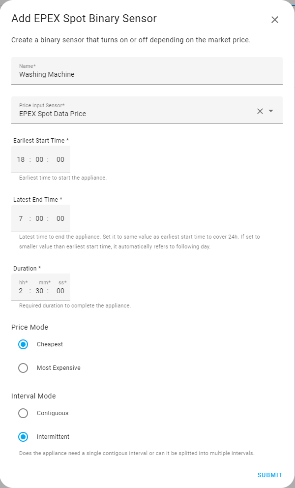

# EPEX Spot Sensor Examples

## Washing Machine (static sensor usage)



A basic example using the sensor with static, fixed values for
`earliest_start_time`, `latest_end_time` and `duration`, set once in the
helper configuration and never changed afterwards.

## Dishwasher (dynamic sensor usage)

Run the dishwasher in a dynamically set cheap price window. The start time
of the window is set by a trigger — in this example, the dishwasher's
"remote start" button.

**Use case:** After breakfast, lunch, or dinner I load the dishwasher and
want it to run during a cheap price period. However, I can't simply wait
for the cheapest period of the whole day (which would be the static
behavior), because the dishwasher must finish within 4 hours after
breakfast or lunch. After dinner, the allowed window is longer, since I
empty the dishwasher the next morning anyway.

### Step 1: Create two time helpers

Create two `input_datetime` helpers — one for the start time, one for the
end time of the window.

```yaml
has_date: false
has_time: true
editable: true
hour: 7
minute: 44
second: 14
icon: mdi:clock-start
friendly_name: dishwasher begin/end
```

### Step 2: Create a new EPEX Spot Sensor

Create a new EPEX Spot Sensor helper. Instead of fixed times, link
`earliest_start_time` and `latest_end_time` to the two `input_datetime`
entities created in Step 1. Configure the remaining options (`duration`,
`price_mode`, `interval_mode`) as usual.

### Step 3: Automation — updating the time window

This runs whenever the dishwasher's remote-start button turns on. It sets
`dishwasher_window_start` to the current time, and calculates
`dishwasher_window_end` depending on the time of day:

- **Before 18:00:** window is 4 hours (breakfast/lunch).
- **From 18:00:** window end is fixed at 04:30 the next morning (dinner —
  the dishwasher is emptied the next morning anyway, so a long overnight
  window into the cheap tariff period is fine).

The guard conditions (`moving_time_frame: off` and `switch.dishwasher_power:
off`) prevent the window from being overwritten while a cheap-price cycle
is currently active or already running. Note that the sensor's `enabled`
attribute is deliberately *not* used here — it only reflects whether the
current time falls within the configured search window, not whether the
dishwasher is actually running, so it isn't a reliable guard for this
purpose.

```yaml
choose:
  # Case 1: before 18:00 -> 4h window from now
  - conditions:
      - condition: state
        entity_id: binary_sensor.epex_spot_sensor_moving_time_frame
        state: "off"
      - condition: state
        entity_id: switch.dishwasher_power
        state: "off"
      - condition: time
        before: "18:00:00"
    sequence:
      - action: input_datetime.set_datetime
        target:
          entity_id: input_datetime.dishwasher_window_start
        data:
          time: "{{ now().strftime('%H:%M:%S') }}"
      - action: input_datetime.set_datetime
        target:
          entity_id: input_datetime.dishwasher_window_end
        data:
          time: "{{ (now() + timedelta(hours=4)).strftime('%H:%M:%S') }}"

  # Case 2: after 18:00 -> fixed end time in the cheap overnight tariff
  - conditions:
      - condition: state
        entity_id: binary_sensor.epex_spot_sensor_moving_time_frame
        state: "off"
      - condition: state
        entity_id: switch.dishwasher_power
        state: "off"
      - condition: time
        after: "17:59:59"
    sequence:
      - action: input_datetime.set_datetime
        target:
          entity_id: input_datetime.dishwasher_window_start
        data:
          time: "{{ now().strftime('%H:%M:%S') }}"
      - action: input_datetime.set_datetime
        target:
          entity_id: input_datetime.dishwasher_window_end
        data:
          time: "04:30:00"
```

### Step 4: Reacting to the sensor's output

The sensor itself exposes a binary sensor (here:
`binary_sensor.epex_spot_sensor_moving_time_frame`) that turns `on` once
the current time falls inside the cheapest window it calculated. The
automation is also triggered by this entity, and uses its state as a
condition to actually start the dishwasher — combined with the
dishwasher's own readiness state:

```yaml
conditions:
  - condition: state
    entity_id: binary_sensor.epex_spot_sensor_moving_time_frame
    state: "on"
  - condition: state
    entity_id: sensor.dishwasher_operation_state
    state: ready
  - condition: state
    entity_id: binary_sensor.dishwasher_remote_start
    state: "on"
```

If all three are true, the dishwasher is started. What happens after that
(selecting a program, etc.) is specific to the dishwasher integration and
not shown here — see the full automation below.

### Full automation (for reference)

The snippets above show the parts relevant to this sensor. The complete
automation, including the trigger and the dishwasher-specific start
sequence, is included below for completeness — it is not commented in
detail here, as the dishwasher integration itself is outside the scope of
this example. (Tested with BSH dishwasher and HA integration)

```yaml
alias: Dishwasher - run during cheap electricity window
description: >
  Demonstrates dynamic earliest_start_time / latest_end_time using
  input_datetime helpers instead of fixed values. Before 18:00, use a
  4-hour window starting now. After 18:00, extend the window into the
  cheap overnight tariff period (until 04:30 the next day).
triggers:
  - trigger: state
    entity_id:
      - binary_sensor.dishwasher_remote_start
    to: "on"
  - trigger: state
    entity_id:
      - binary_sensor.epex_spot_sensor_moving_time_frame
    to: "on"
conditions: []
actions:
  - choose:
      - conditions:
          - condition: state
            entity_id: binary_sensor.epex_spot_sensor_moving_time_frame
            state: "off"
          - condition: state
            entity_id: switch.dishwasher_power
            state: "off"
          - condition: time
            before: "18:00:00"
        sequence:
          - action: input_datetime.set_datetime
            target:
              entity_id: input_datetime.dishwasher_window_start
            data:
              time: "{{ now().strftime('%H:%M:%S') }}"
          - action: input_datetime.set_datetime
            target:
              entity_id: input_datetime.dishwasher_window_end
            data:
              time: "{{ (now() + timedelta(hours=4)).strftime('%H:%M:%S') }}"
      - conditions:
          - condition: state
            entity_id: binary_sensor.epex_spot_sensor_moving_time_frame
            state: "off"
          - condition: state
            entity_id: switch.dishwasher_power
            state: "off"
          - condition: time
            after: "17:59:59"
        sequence:
          - action: input_datetime.set_datetime
            target:
              entity_id: input_datetime.dishwasher_window_start
            data:
              time: "{{ now().strftime('%H:%M:%S') }}"
          - action: input_datetime.set_datetime
            target:
              entity_id: input_datetime.dishwasher_window_end
            data:
              time: "04:30:00"

  - choose:
      - conditions:
          - condition: state
            entity_id: binary_sensor.epex_spot_sensor_moving_time_frame
            state: "on"
          - condition: state
            entity_id: sensor.dishwasher_operation_state
            state: ready
          - condition: state
            entity_id: binary_sensor.dishwasher_remote_start
            state: "on"
        sequence:
          - action: switch.turn_on
            target:
              entity_id: switch.dishwasher_power
          - delay:
              seconds: 10
          - action: select.select_option
            target:
              entity_id: select.dishwasher_active_program
            data:
              option: eco_auto
mode: single
```